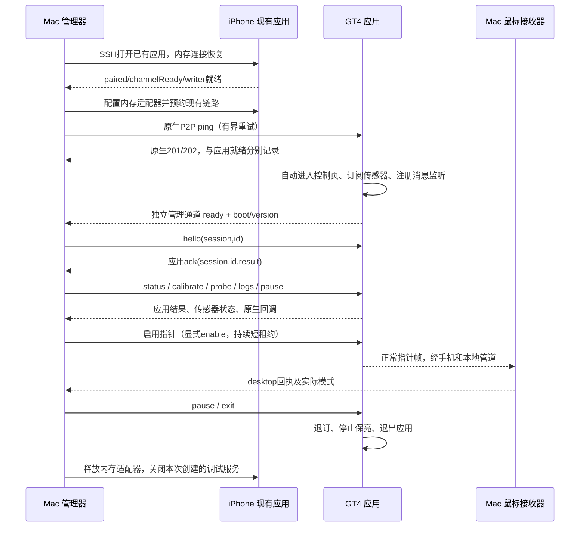

# 电脑管理的 GT4 开发与测试会话

## 实现目标与真机状态

设计目标是由电脑发起调试。实际限制：目前不能稳定从退出状态唤起手表应用，因此尚未实现完全无需手工打开。应用已经运行时，管理器使用现有 iPhone 配对会话执行握手、指令、采样状态、日志读取和停止。表端启动后自动进入控制页并注册接收器，鼠标保持暂停。

1.2.0 已完成无点按的真机验证：手机会话恢复后安装成功，电脑 ping 返回201→202，表端应用发回 ready，hello/status 取得应用 ACK，A/G 计数增长，远程发送对照、取日志和暂停成功。两个发送入口仍失败：wearengine约3016ms、legacy约3884ms，均零错误参数。校准请求被接受，但后续状态没有变成 Ready；这不是校准成功。1.2.1 进一步提供实际加速度/陀螺仪向量、周期 ready 和更完整的会话收尾，须按对应构建的真机记录验收。

## 路径与进程

```text
examples/gt4-airpointer/
  watch/.../common/managed-controller.js  指令、会话、去重、租约
  watch/.../common/managed-link.js        独立管理回传通道
  relay/phone-bootstrap.js               手机原应用的连接恢复，内存执行
  relay/iphone-agent.js                  现有配对 BLE 会话适配器，内存执行
  relay/manager.py                       电脑控制器、Frida隔离子进程、Unix socket
  scripts/manage.sh                      电脑管理入口
  build/manager.sock                     本机IPC，权限600
  build/managed/state.json               当前阶段及最近实际结果
  build/managed/events.ndjson            指令、传输ACK、应用事件时间线
  build/managed/wire-stats.json           SID/CID、帧标志、长度和计数
  build/managed/manager.log              控制器错误输出
```

签名包、工具、依赖和日志都留在本工作区。iPhone不增加安装包、脚本、工具或日志文件；Frida脚本经现有服务加载到进程内存。管理器只有本机Unix socket，没有新增局域网控制端口。

## 端到端流程



图中的正常指针帧仍是待打通项；管理通道的真机成功不能代替鼠标数据通道成功。

### 手机连接恢复

电脑用SSH `uiopen --bundleid local.gt4bridge.crescent` 打开现有应用。bootstrap在主线程选择原应用的手表页面，通过明确的“查找手表”、目标GT4连接项、“使用已保存密钥认证”入口恢复现有连接，不确认首次配对。

主适配器只有在 `isPaired && channelReady && writer != nil` 后才加载。第一次恢复超时后，管理器核对并只重启现有 CrescentRelay 进程，再尝试一次；不重装、不清数据、不解除配对。实际遇到的断开中状态 `peripheralState=3` 已通过这个过程恢复。主进程、连接工作进程及每次RPC都有期限，status/stop不会被一次无响应的Frida调用无限堵塞。

### 表端启动与握手

先用已知P2P端点 `0x34/0x01` 的kind1 ping尝试唤起应用。原生201说明尚未运行；202说明原生层报告运行。官方说明手机ping可以启动表端应用，随后应用需要注册消息监听：[iOS消息流程](https://developer.huawei.com/consumer/en/doc/connectivity-guides/phone-send-message-ios-0000001875158886/)。曾在安装后观察到201→202→应用ready，但后续多轮始终返回201，不能据此前一次结果宣称通用冷启动已验证。

表端欢迎页300ms后自动进入控制页，再初始化Wear Engine，避免首屏同步初始化。注册和探测完成后，上送带boot/version的应用ready。管理器取得ready后发送hello，收到相同session/id的应用ACK，再执行status；这些均通过才标记controlReady。

boot改变时撤销已握手状态，不能把旧进程的ACK或传感器状态当成本次成功。1.2.1周期发出ready，供管理器重新连接到仍在前台的应用。硬件断电或无线不可达时没有软件唤起能力；管理器记录失败阶段，不把要求用户点按当成正常调试步骤。

## 控制协议

下行走手机→手表P2P数据消息，核对配置的包名及应用身份。指令是限定操作的JSON，不接受脚本、任意路由或任意原生API名称。

```json
{"v":1,"t":"command","session":"0123456789abcdef","id":17,"op":"status","args":{},"ttl":15000}
```

| 操作 | 功能与验收 |
| --- | --- |
| hello | 建立会话，返回版本及状态；确认是否允许桌面输入 |
| status | 获取页面、真实A/G计数、采样向量、校准状态、暂停状态 |
| calibrate | 开始真实样本校准；随后必须检查Ready，不能只凭接受请求判成功 |
| arm / pause | 启用或暂停；arm要求校准完成及本地enable |
| heartbeat | 续租1500ms输入许可；只等传输写入，不阻塞等待应用ACK |
| mode / gain / button | 限定模式、灵敏度和按钮枚举，禁止任意输入参数 |
| pointer | 启停正常指针帧输出，不自动代表数据已送达 |
| probe | 单次指定发送入口对照，回传耗时、参数个数及受限错误摘要 |
| logs | 取回应用自己的有界原生回调记录 |
| test | 排队一帧带明确测试来源、未启用输入的传输测试，必须另查接收证据 |
| exit | 回复退出请求，停止订阅和保亮，再调用Lite应用terminate |

同一会话指令ID严格递增；已完成的重复指令返回缓存ACK，避免重复点击。旧会话、未知操作、过期执行和不合格式的数据拒绝。输入采用短租约，心跳中断会自动暂停；页面隐藏、退出或传感器超时也会暂停。

上行管理事件使用已实测可用的探测回传：JSON→48字符分段→十六进制→`local.gt4bridge.crescent.gt4rpc.s<token>.p<part>n<total>.x<hex>`。每个快照最多960字符、20段，队列有界，状态合并，指令ACK优先。它独立于故障中的sendMsg发送通道，不用于冒充正常指针数据。收不到完整JSON就不产生应用ACK。

## 测试与观测

| 阶段 | 自动操作 | 通过证据 |
| --- | --- | --- |
| 构建 | SDK编译、私有webpack模块ID压缩、ES5压缩、签名 | 实际Lite JerryScript解析通过；CMS/Profile/摘要通过 |
| 安装 | 在当前配对会话上传到手表并升级本应用 | 文件有效性1、安装102、应用列表精确版本 |
| 手机恢复 | 打开现有应用、恢复已有连接 | paired/channelReady/writer真实状态 |
| 表端启动 | ping有界重试 | 原生202以及不同层的应用ready |
| 双向管理 | hello、status | 相同boot/session/id的应用ACK |
| 传感器 | 间隔取两次status | 真实A/G计数增长，向量及错误状态可读取 |
| 校准 | calibrate后轮询状态 | calibration=Ready；请求被接受不算通过 |
| 发送对照 | 单次wearengine/legacy probe | 原生回调、耗时、手机是否收到实际数据分别记录 |
| 指针 | 启动接收器、校准、启用、续租 | watch真实帧→Mac接收→desktop回执；合成向量须单独标明 |
| 退出与重启 | exit、停止管理器、重新start | 退出后可再次ping启动并取得新boot、重新握手 |
| 收尾 | 释放预约、退订、退出、关闭自己创建的服务 | 清理结果、残留进程/端口检查 |

离线测试覆盖会话/ID/重复指令、租约、分段限额、跨会话ACK拒绝、Frida总期限、进程所有权、心跳与指令并发顺序、编译后脚本执行和JerryScript解析。离线结果与真机结果分开保存。

控制器提供 `start/status/command/test/stop` 接口供开发代理调用。用户无需执行这些命令；具体调用形式见项目README。测试失败保留所属阶段与证据，继续运行可独立的日志获取和暂停步骤，不把底层207当成应用逻辑成功。
